<p align="center">
  
</p>

<p align="center">
  <a href="https://flagiq.org"></a>
  <a href="https://x.com/mustang_akin"></a>
  
  
</p>

---

### 👋 The short version

I'm **Akintunde Solarin**. I run **[FlagIQ](https://flagiq.org)**, an AI agency in Lagos, and **Flag Skool**, where I've trained **750+ students** to build with AI.

My style is to **ship first and polish second.** I build fast with AI tooling (Claude Code, Cursor, Lovable, AI Studio), then do the real engineering work: auth, payments, databases and deploys. Clients get something they can actually click on in days, not a deck in weeks.

```yaml
currently:   building AI agents for real businesses (more dropping here soon 👀)
shipping:    client web apps, internal tools, AI automations
teaching:    Flag Skool, Cohort 2 (AI-assisted coding), January 2027
studying:    B.Eng Electrical & Electronics Engineering, UNILAG
ask me about: agents · n8n · Supabase · Next.js · turning a messy business process into software
```

---

### 🤝 Work with me

If you're one of these, let's talk:

| You are… | I'll build you… |
|---|---|
| 🏪 **A business** still running on WhatsApp, notepads and spreadsheets | A custom web app with orders, customers, admin dashboard and payments. |
| 🚀 **A founder** with an idea and no tech team | A working MVP you can demo to users and investors, built in weeks, not quarters |
| ⚙️ **A team** drowning in repetitive work | AI agents and n8n automations that scrape, score, draft, send and log on autopilot |
| 🎓 **An org** that wants its people AI-literate | Hands-on AI training, the same playbook behind Flag Skool |

**→ Reach me:** DM on [X @mustang_akin](https://x.com/mustang_akin) or go through **[flagiq.org](https://flagiq.org)**

---

### 🤖 Agent Lab

> Agents I've built that do real work while I sleep. This section is growing. ⭐ / follow to catch new drops.

<table>
<tr>
<td width="50%" valign="top">

#### 🎯 Job-Hunt Agent
Scrapes Hacker News *"Who is Hiring"*, **scores every listing with Gemini**, drafts a personalised application email for the good ones, sends through Resend from a verified domain, and logs everything to Supabase. Runs **daily on a GitHub Actions cron**, with a `REVIEW_MODE` safety switch so nothing goes out until the drafts are right.

`Python` `Gemini` `Supabase` `Resend` `GitHub Actions`

</td>
<td width="50%" valign="top">

#### 💼 Client Offer Machine
Paste any company's website and get back **three AI-automation offers** a freelancer could sell them, with **naira pricing** and a ready-to-send cold DM. Built **live in front of the Flag Skool community**. The real product is the prompt: a strict rule set that stops the model writing generic "AI-powered solutions" filler.

`Next.js` `LLM prompt engineering` `mobile-first`

</td>
</tr>
<tr>
<td width="50%" valign="top">

#### 🎙️ Aura: Voice AI for fintech
A voice AI customer-service agent for a fintech, plus the ops side around it: a [performance dashboard](https://github.com/mustangakin/auradashboard) (call logs, KPIs, charts) and an [insights console](https://github.com/mustangakin/aura-finance-insights) with fraud reports, audit logs and a knowledge base.

`Voice AI` `Gemini` `React` `Recharts` `Express`

</td>
<td width="50%" valign="top">

#### 📄 Technical Report Generator
Feed it scanned SIWES logbook pages and it produces a **complete, formatted technical report** (Word + print-ready PDF), plus a JSON audit that **scores the report against UNILAG's official marking scheme**.

`Python` `Document AI` `PDF/DOCX pipeline`

</td>
</tr>
</table>

---

### 🛠️ Built for clients

| Project | What it does | Stack |
|---|---|---|
| 🎈 **[Ruve's Party Concepts](https://github.com/mustangakin/ruves-party-concepts)** · [live ↗](https://ruvespartyconcepts.com) | Website + shop + quote requests + admin panel for a luxury event design studio in Lagos | Next.js · Supabase · Resend · Zod |
| 💸 **[FlagTech Wage Calculator](https://github.com/mustangakin/flagtech-wage-calculator)** | Tracks workers, clients and weekly hours, then works out wages (USD + NGN), revenue and margins for a remote workforce | Next.js · Supabase |
| 🎟️ **SignOut Tickets** 🔒 | Ticketing app for a university engineering sign-out party | Next.js |
| 🚚 **[Eazy Logistics](https://github.com/mustangakin/eazy-logistics-build)** | Freight platform with quote booking, live shipment tracking, status timelines, an admin fleet map and shipment management | Next.js · Prisma · NextAuth · Leaflet |
| 📝 **[AI Trainer Applications](https://github.com/mustangakin/form)** | Recruitment landing page where every application goes through an n8n webhook into Google Sheets | React · Zod · n8n |

<sub>🔒 = private / client repo. Happy to walk you through it on a call.</sub>

---

### 🧪 Products & R&D

- **🏫 Flag School** 🔒: a course platform for African creators with video lessons and **Paystack** payments (cards, bank transfer, USSD). `Next.js 16` `Supabase` `Prisma` `Paystack`. Landing page: [flag-skool-ai-landing](https://github.com/mustangakin/flag-skool-ai-landing)
- **📐 Intelligent Vectorizer (final-year project)**: turns scanned electrical schematics into **editable SVG/DXF**. It detects symbols with **YOLOv8**, reads labels with **Tesseract OCR** and traces wires with **OpenCV Hough transforms**. Packaged as an **Inkscape extension** with a web demo.
- **🧠 Multi-agent workspace**: one shared instruction and memory layer (`AGENTS.md` / `CLAUDE.md` / `GEMINI.md`) so Claude Code, Codex and Gemini all work from the same context across every project.
- **📓 [pytorch_learning](https://github.com/mustangakin/pytorch_learning)**: my deep learning notebooks, from tensors up.

---

### 🧰 Toolbox

**Build**<br/>


**AI & Agents**<br/>


**Ship**<br/>


**Vibe-coding rig**<br/>


---

### 📣 Elsewhere

I teach AI in public on **[X @mustang_akin](https://x.com/mustang_akin)** (4,100+ followers, 900K+ impressions on AI education content). If you're in Nigeria and want to become an AI generalist, **Flag Skool** is where we build together.

<p align="center">
  
</p>

<p align="center"><sub>🇳🇬 Built in Lagos. Shipped everywhere.</sub></p>
